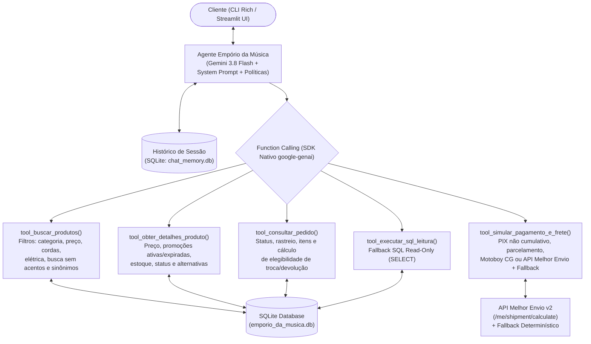

# Agente de Atendimento - Empório da Música

Agente conversacional em Python desenvolvido para auxiliar a equipe de atendimento.

O agente combina **Function Calling determinístico sobre SQLite**, **injeção integral das políticas da loja no System Prompt**, **integração com a API v2 do Melhor Envio (com fallback local)** e **interfaces em CLI (`Rich`) e Web (`Streamlit`)**.

---

## Sumário

1. [Como Executar o Projeto](#-1-como-executar-o-projeto)
2. [Arquitetura e Justificativa das Decisões Técnicas](#-2-arquitetura-e-justificativa-das-decisões-técnicas)
3. [Tratamento de Dados, Casos de Borda e Premissas Assumidas](#-3-tratamento-de-dados-casos-de-borda-e-premissas-assumidas)
4. [Avaliação Técnica: API do Melhor Envio para Frete](#-4-avaliação-técnica-api-do-melhor-envio-para-frete)
5. [Exemplos de Interação com o Agente](#-5-exemplos-de-interação-com-o-agente)
6. [Limitações Conhecidas e Próximos Passos](#-6-limitações-conhecidas-e-o-que-faria-com-mais-tempo)
7. [Uso de Assistentes de Código e Registro do Workflow](#-7-uso-de-assistentes-de-código-e-registro-do-workflow)

---

## 1. Como Executar o Projeto

### Pré-requisitos
- **Python 3.11+** (testado em Python 3.14)
- Chave de API do **Google AI Studio** (`GEMINI_API_KEY`)
- Pasta `data/` original fornecida no desafio copiada na raiz do projeto (não versionada no Git por boas práticas):
  - `data/desafio_tecnico_ai_eng - categories.csv`
  - `data/desafio_tecnico_ai_eng - customers.csv`
  - `data/desafio_tecnico_ai_eng - order_items.csv`
  - `data/desafio_tecnico_ai_eng - orders.csv`
  - `data/desafio_tecnico_ai_eng - products.csv`
  - `data/desafio_tecnico_ai_eng - promotions.csv`
  - `data/políticas_da_loja.pdf` (será automaticamente renomeado para `data/politicas_da_loja.pdf` sem acento e convertido em `data/politicas_da_loja.md` no Passo 3)

### Passo 1: Criar ambiente virtual e instalar dependências

```bash
python3 -m venv .venv
source .venv/bin/activate
pip install -r requirements.txt
```

### Passo 2: Configurar variáveis de ambiente

Copie o template `.env.example` para `.env` e preencha sua chave `GEMINI_API_KEY`:

```bash
cp .env.example .env
```

Conteúdo principal do `.env`:
```env
GEMINI_API_KEY=sua_chave_do_google_ai_studio
GEMINI_MODEL=gemini-3.8-flash
REFERENCE_DATE=2026-03-25

# Opcional: Token do Melhor Envio (se vazio, usa o simulador determinístico de contingência)
MELHOR_ENVIO_TOKEN=
MELHOR_ENVIO_SANDBOX=false
```

### Passo 3: Converter o PDF de Políticas para Markdown via `gemini-3.5-flash-lite`

Com a pasta `data/` original na raiz e a `GEMINI_API_KEY` configurada no `.env`, execute o script abaixo para converter `data/politicas_da_loja.pdf` em `data/politicas_da_loja.md` utilizando a leitura multimodal nativa de PDF do modelo `gemini-3.5-flash-lite`:

```bash
python convert_pdf.py
```

*(Nota: Caso você pule este comando, o próprio agente detectará a ausência do `.md` e fará a conversão automática do `.pdf` na primeira inicialização).*

### Passo 4: Executar a Interface Web (Streamlit) ou a CLI Interativa (Rich)

#### Opção A — Interface Web (Streamlit com Inspetor de Tool Calls)
```bash
streamlit run app.py
```

#### Opção B — Interface de Linha de Comando (Rich CLI)
```bash
# Modo de conversa contínua
python cli.py

# Enviar uma mensagem única e exportar a conversa em Markdown
python cli.py --session teste_rapido -m "Quais opções de violões disponíveis custando até R$1000?" --export conversa.md
```

### Passo 5: Executar a Suíte de Testes Automatizados (`pytest`)

```bash
python -m pytest -v
```

---

## 2. Arquitetura e Justificativa das Decisões Técnicas



### 2.1 Abordagem Híbrida (Tools de Negócio sobre SQLite + Políticas no Contexto + Fallback SQL Read-Only)
- **Por que não usar apenas Text-to-SQL livre para tudo?**
  Os CSVs da loja possuem regras de negócio críticas acopladas ao manual de políticas: por exemplo, o desconto de 5% no PIX **não acumula** com promoções ativas (`is_active = 1`), produtos com `status = 'discontinued'` possuem estoque positivo residual que não pode ser vendido (`product_id = 136`), e produtos ativos podem ter `stock_quantity = 0` (`product_id = 96`). Um agente SQL livre facilmente esqueceria um `LEFT JOIN promotions WHERE is_active = 1` ou um filtro de `status`. Ao encapsular essas regras na view `v_products_enriched` e nas *tools* determinísticas (`buscar_produtos`, `obter_detalhes_produto`, `simular_pagamento_e_frete`, `consultar_pedido`), garantimos **zero alucinação aritmética** e **100% de conformidade com a Seção 7.3**.
- **Por que incluir uma tool de Fallback SQL Read-Only (`executar_sql_leitura`)?**
  Mantém a flexibilidade de um agente analítico caso o usuário faça perguntas agregadas fora do padrão das tools principais, com *guardrails* estritos (conexão SQLite `mode=ro` e bloqueio via regex contra comandos de modificação).
- **Por que injetar `politicas_da_loja.md` no System Prompt em vez de RAG vetorial com chunking?**
  O manual completo de políticas possui apenas **235 linhas (~2.500 tokens)**. Em documentos curtos e densos em regras, o *chunking* de um RAG vetorial frequentemente causa erros graves de contexto (ex.: recuperar a Tabela 3 que diz *"parcela mínima de R$ 100,00"* sem recuperar a Seção 3.1 que permite parcelas mínimas de R$ 50,00 até 3x e R$ 80,00 de 4x a 6x). Com janelas de contexto modernas da família Gemini Flash, manter o manual íntegro no *System Prompt* elimina falhas de *retrieval* e reduz a latência.

### 2.2 Orquestração: SDK Nativo (`google-genai`) + `Pydantic`
- Optamos por construir o loop de *function calling* diretamente sobre o SDK oficial `google-genai` com contratos de entrada/saída tipados em `Pydantic` (`src/schemas.py`), sem depender de abstrações pesadas como LangChain.
- Isso torna o controle de estado, o rastreamento de latência de cada ferramenta (`duration_ms`) e a inspeção de chamadas totalmente transparentes e fáceis de testar unitariamente (`tests/`).

### 2.3 Modelo e Provedor: Google Gemini (`gemini-3.8-flash` / `gemini-3.5-flash-lite`)
- Configurado por padrão para utilizar `gemini-3.8-flash` (parametrizável via `GEMINI_MODEL` no `.env`), disponibilizando na interface web as opções `gemini-3.8-flash` e `gemini-3.5-flash-lite`.

### 2.4 Persistência de Histórico e Interfaces
- O histórico de conversas é persistido localmente em SQLite (`chat_memory.db` via `src/memory.py`), registrando tanto as mensagens quanto os metadados das *tool calls* acionadas em cada turno, permitindo retomar sessões e exportá-las diretamente para Markdown.

---

## 3. Tratamento de Dados, Casos de Borda e Premissas Assumidas

Durante a análise exploratória dos arquivos em `data/`, mapeamos e tratamos os seguintes casos de borda:

1. **Conflito entre `status` e `stock_quantity` em `products.csv` (Seção 7.3)**:
   - **`product_id = 96` (*Giannini GF-3D Dreadnought Sunburst*, R$ 799,90)**: Possui `status = active`, mas `stock_quantity = 0`. Nossa view `v_products_enriched` classifica-o como `sem_estoque` (`is_available = 0`), separando-o dos produtos disponíveis e recomendando alternativas em estoque.
   - **`product_id = 136` (*Ibanez Bass 2X Electric Bass*)**: Possui `stock_quantity = 13`, porém `status = discontinued`. As ferramentas bloqueiam sua oferta para venda imediata, alertam que o modelo saiu de linha e sugerem baixos ativos equivalentes.
   - **`product_id = 113` (*Shelby SN-7C 7 Cordas*)**: `status = discontinued` e `stock_quantity = 0`.
   - **`product_id = 130` (*Kala KA-ABP-CTG Barítono Cedar*)**: `status = coming_soon` (`em_breve`) e `stock_quantity = 2`.
2. **Categorias sem Produtos Cadastrados**:
   - As categorias `6` (*Instrumentos de Sopro - Madeiras*), `7` (*Instrumentos de Sopro - Metais*) e `8` (*Cordas Orquestrais*) existem em `categories.csv` e no texto institucional da loja, mas têm **0 registros** em `products.csv`. A ferramenta `buscar_produtos` detecta buscas por esses instrumentos e informa com transparência que a categoria está temporariamente sem estoque.
3. **Promoções Ativas vs. Expiradas (`promotions.csv`) e Regra do PIX (Seções 6.2 e 7.3)**:
   - De 25 promoções cadastradas, apenas **4 estão ativas (`is_active = 1`)**: produtos `90` (*Crafter HT-100*, 18% OFF), `94` (*Taylor 110e*, 8% OFF), `121` (*Ohana CK-20*, 20% OFF) e `127` (*Kalani KAL-700T*, 10% OFF).
   - As outras 21 promoções estão expiradas (`is_active = 0`), incluindo o *Takamine GD20* (`product_id = 95`, que teve 12% OFF no passado). A ferramenta `obter_detalhes_produto` retorna tanto o preço vigente quanto o histórico de promoções encerradas para que o agente esclareça dúvidas de clientes com transparência.
   - O cálculo de PIX aplica 5% de desconto **apenas** quando o produto não possui promoção ativa (`pix_discount_applied = False` em itens promocionais).
4. **Inconsistências Internas no Documento `politicas_da_loja.md`**:
   - **Parcelamento (Tabela 3 vs. Seção 3.1)**: A Tabela 3 resume *"Parcela mínima de R$ 100,00"*, enquanto a Seção 3.1 detalha a regra escalonada: até 3x (mín. R$ 50,00), 4x a 6x (mín. R$ 80,00) e 7x a 12x (mín. R$ 100,00). Assumimos a regra detalhada da **Seção 3.1** como a regra operacional de cálculo na ferramenta `simular_pagamento_e_frete`.
   - **Telefones e E-mail**: O cabeçalho e o item 1.2 informam `(67) 3341-4444`, enquanto a Seção 7 informa `(67) 3321-4500` para WhatsApp; a tabela 1.2 grafou o e-mail com acento (`contato@empóriodamusica.com.br`). Harmonizamos no prompt ambos os números (fixo e WhatsApp) e o e-mail válido sem acento (`contato@emporiodamusica.com.br`).
5. **Data de Referência para Prazos de Devolução (`orders.csv`)**:
   - Os pedidos em `orders.csv` possuem datas entre `2025-10-15` e `2026-03-22`. Para tornar a verificação de elegibilidade de **7 dias corridos (arrependimento/preferência)**, **30 dias corridos (troca por defeito na loja)** e **90 dias (garantia legal CDC)** reproduzível, adotamos a data de referência padrão `REFERENCE_DATE=2026-03-25` (configurável via `.env`).

---

## 4. Avaliação Técnica: API do Melhor Envio para Frete

Avaliamos e implementamos a integração com a API v2 do **Melhor Envio** (`POST /api/v2/me/shipment/calculate`) em `src/shipping.py`:

1. **Aderência às Transportadoras da Loja**: A Seção 5.2 trabalha com **Correios (PAC e SEDEX)** e **Jadlog (.package)**, que correspondem exatamente aos serviços `1,2,3` da API do Melhor Envio, com seguro (`insurance_value`) e rastreamento incluídos.
2. **Solução para Lacuna de Peso e Dimensões em `products.csv`**: Como o arquivo `products.csv` traz apenas especificações musicais na coluna JSON `specs` (sem `weight`, `width`, `height`, `length`), criamos perfis físicos padrão por categoria (`CATEGORY_SHIPPING_PROFILES` em `src/shipping.py`) e adicionamos o alerta automático da Seção 5.2 para instrumentos de grande porte (baterias, pianos digitais e contrabaixos).
3. **Tratamento da Regra Local de Campo Grande (Seção 5.1)**: Destinos em Campo Grande/MS são interceptados antes da chamada externa para aplicar a entrega por **motoboy próprio** (1 a 3 dias úteis, **Frete Grátis** para pedidos > R$ 500,00 e **taxa fixa de R$ 35,00** até R$ 500,00).
4. **Padrão Strategy com *Graceful Fallback***: Caso o avaliador configure `MELHOR_ENVIO_TOKEN` no `.env`, a cotação consulta a API v2 do Melhor Envio em tempo real; caso não possua token configurado (ou sem internet), o módulo utiliza automaticamente a calculadora determinística local calibrada por região de CEP, cubagem e seguro, garantindo que o projeto rode *out-of-the-box*.

---

## 5. Exemplos de Interação com o Agente

Na pasta [`examples/`](./examples) estão disponíveis **5 conversas completas** em Markdown (com registro das ferramentas invocadas e argumentos passados pelo agente), geradas e validadas sobre os dados reais do banco:

1. [**`examples/01_catalogo_violoes_ate_1000_e_estoque.md`**](./examples/01_catalogo_violoes_ate_1000_e_estoque.md) — Consulta de violões disponíveis até R$ 1.000,00 (filtrando o *Giannini GF-3D* com estoque zero) e aplicação da regra escalonada de parcelamento (Seção 3.1) e frete grátis em Campo Grande.
2. [**`examples/02_preco_takamine_gd20_promocao_pix_e_frete.md`**](./examples/02_preco_takamine_gd20_promocao_pix_e_frete.md) — Consulta do *Takamine GD20* (esclarecendo a promoção expirada de 12%), comparação com o *Crafter HT-100* (promoção ativa de 18% OFF), regra de não-cumulatividade do PIX (Seção 6.2) e cotação de frete para Dourados/MS.
3. [**`examples/03_devolucao_arrependimento_e_troca_pedidos.md`**](./examples/03_devolucao_arrependimento_e_troca_pedidos.md) — Aplicação das políticas de devolução por arrependimento (7 dias) e garantia legal (90 dias) cruzando em tempo real os pedidos `#7` (entregue há 36 dias) e `#8` (em trânsito) de `orders.csv`.
4. [**`examples/04_produto_descontinuado_e_escopo_acessorios.md`**](./examples/04_produto_descontinuado_e_escopo_acessorios.md) — Atendimento combinando endereço, alerta de horário de sábado (fecha às 13h), bloqueio de produto descontinuado com saldo residual (*Ibanez Bass 2X*, `product_id=136`) com sugestão de similares e redirecionamento educado para acessórios fora do escopo (cordas, palhetas e amplificador).
5. [**`examples/05_fora_de_escopo_e_categorias_sem_estoque.md`**](./examples/05_fora_de_escopo_e_categorias_sem_estoque.md) — Consulta por instrumentos de categorias sem estoque (*Saxofone* e *Violino*) combinada com *guardrail* contra perguntas fora do escopo (receita culinária e imposto de renda).

---

## 6. Limitações Conhecidas e O Que Faria com Mais Tempo

- **Autenticação real do titular do pedido (LGPD)**: Atualmente, a consulta de pedidos valida o número do pedido ou nome/e-mail/telefone informado na conversa e mascara o e-mail no retorno. Em produção no WhatsApp, integraríamos um fluxo de confirmação via token OTP ou validação automática do número de telefone remetente na API oficial do WhatsApp Business.
- **Busca Semântica Híbrida (BM25 + Embeddings)**: Para um catálogo de 65 itens, a busca normalizada com expansão de sinônimos e filtros estruturados em SQLite tem latência < 5ms e alta precisão. Caso o catálogo crescesse para dezenas de milhares de itens, adicionaríamos busca vetorial (`sqlite-vec` ou `pgvector`) combinada com *Full-Text Search* (FTS5).
- **Observabilidade e Avaliação Contínua (LLM-as-a-Judge)**: Com mais tempo, adicionaríamos rastreamento OpenTelemetry (Arize Phoenix / Langfuse) e um dataset de avaliação automatizada verificando métricas de *faithfulness* e aderência às políticas a cada alteração de prompt.

---

## 7. Uso de Assistentes de Código e Registro do Workflow

Este projeto foi desenvolvido em *pair programming* com o **Antigravity IDE 2.6.0** utilizando o modelo **Gemini 4 Argon**.

### Workflow Utilizado
1. **Exploração e Diagnóstico Antes do Código**: O assistente foi instruído a ler o enunciado e auditar os arquivos CSV e o manual de políticas antes de escrever qualquer código, revelando as armadilhas de dados (`stock_quantity = 0` em produto ativo, `status = discontinued` com estoque 13, promoções expiradas e conflito entre Tabela 3 e Seção 3.1).
2. **Alinhamento de Decisões Arquiteturais**: Elaboração de um plano de ação (`implementation_plan.md`) com múltiplas alternativas técnicas e avaliação específica da API do Melhor Envio.
3. **Desenvolvimento Incremental Orientado a Testes (`pytest`)**: Implementação modular em etapas (ingestão SQLite $\rightarrow$ módulo de frete $\rightarrow$ tools de negócio $\rightarrow$ agente Gemini $\rightarrow$ interfaces CLI/Streamlit $\rightarrow$ exemplos e documentação), validando cada camada com testes automatizados.

### Prompts Utilizados

Antigravity com Gemini 4 Argon.

1 - Estou participando de um processo seletivo e preciso fazer um desafio técnico. Leia o arquivo `desafio_tecnico_ai_eng_artef4ct.md` e siga as instruções. Antes de escrever código, monte um plano de ação com algumas opções de decisões técnicas.

2 - Parece legal. Salve o plano de implementação na raiz do projeto.
No "Modelo / Provedor" podemos utilizar o Google Gemini mais atualizado: "gemini-3.8-flash".
Para o cálculo do frete, faça a avaliação de utilizar a API do "Melhor Envio".

3 - Legal, funcionou. Mas na interface web do Streamlit, quando o agente responde algo com preço em Reais Brasileiro (R$) está ficando quebrada a formatação.

4 - Vamos remover o fallback model (gemini-2.5-flash). Na lista de modelos disponíveis vamos deixar somente: "gemini-3.8-flash" e "gemini-3.5-flash-lite".

### Perguntas de Alinhamento Arquitetural

- Qual abordagem arquitetural você prefere para o agente e o acesso aos dados/políticas?
    - Híbrida: Tools de negócio sobre SQLite + Políticas completas no contexto + Fallback SQL read-only

- Qual framework de orquestração em Python você prefere utilizar?
    - SDK Nativo / Leve + Pydantic (sem LangChain/LangGraph, código puro e direto)

- Qual provedor de LLM você tem chave disponível (ou prefere usar como principal)?
    - Apenas Google Gemini (ex.: gemini-2.5-flash / gemini-3.8-flash via Google AI Studio)

- Qual interface de interação você prefere entregar?
    - CLI Interativa (Rich) + Web UI (Streamlit com inspetor de Tool Calls) + Persistência SQLite/JSON

---
