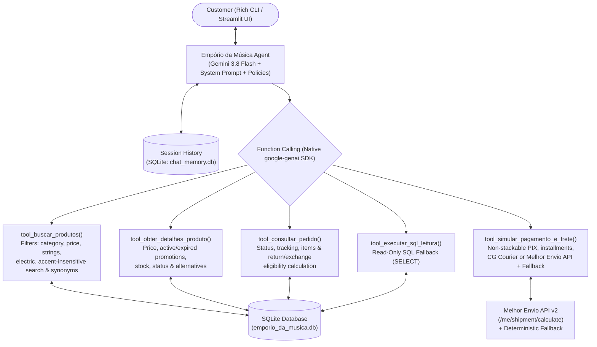

# Customer Support Agent - Empório da Música

_Read this in other languages: [Português](README.pt-BR.md)._

Conversational Python agent built to assist the customer support team.

The agent combines **deterministic Function Calling over SQLite**, **full store policy injection in the System Prompt**, **integration with the Melhor Envio v2 API (with local fallback)**, and **both CLI (`Rich`) and Web (`Streamlit`) interfaces**.

---

## Table of Contents

1. [How to Run the Project](#1-how-to-run-the-project)
2. [Architecture and Rationale for Technical Decisions](#2-architecture-and-rationale-for-technical-decisions)
3. [Data Handling, Edge Cases, and Assumptions](#3-data-handling-edge-cases-and-assumptions)
4. [Technical Evaluation: Melhor Envio API for Shipping](#4-technical-evaluation-melhor-envio-api-for-shipping)
5. [Agent Interaction Examples](#5-agent-interaction-examples)
6. [Known Limitations and Next Steps](#6-known-limitations-and-what-i-would-do-with-more-time)
7. [Coding Assistant Usage and Workflow Log](#7-coding-assistant-usage-and-workflow-log)

---

## 1. How to Run the Project

### Prerequisites
- **Python 3.11+** (tested on Python 3.14)
- **Google AI Studio** API Key (`GEMINI_API_KEY`)
- Original `data/` folder provided in the challenge copied to the project root (excluded from Git version control following best practices):
  - `data/desafio_tecnico_ai_eng - categories.csv`
  - `data/desafio_tecnico_ai_eng - customers.csv`
  - `data/desafio_tecnico_ai_eng - order_items.csv`
  - `data/desafio_tecnico_ai_eng - orders.csv`
  - `data/desafio_tecnico_ai_eng - products.csv`
  - `data/desafio_tecnico_ai_eng - promotions.csv`
  - `data/políticas_da_loja.pdf` (automatically renamed to `data/politicas_da_loja.pdf` without accents and converted to `data/politicas_da_loja.md` in Step 3)

### Step 1: Create virtual environment and install dependencies

```bash
python3 -m venv .venv
source .venv/bin/activate
pip install -r requirements.txt
```

### Step 2: Configure environment variables

Copy the `.env.example` template to `.env` and fill in your `GEMINI_API_KEY`:

```bash
cp .env.example .env
```

Main `.env` contents:
```env
GEMINI_API_KEY=your_google_ai_studio_key
GEMINI_MODEL=gemini-3.8-flash
MAX_TOOL_ITERATIONS=10
USD_TO_BRL_RATE=5.80
REFERENCE_DATE=2026-03-25

# Optional: Melhor Envio token (if empty, uses the deterministic contingency simulator)
MELHOR_ENVIO_TOKEN=
MELHOR_ENVIO_SANDBOX=false
```

### Step 3: Convert the Store Policies PDF to Markdown via `gemini-3.5-flash-lite`

With the original `data/` folder in the root directory and `GEMINI_API_KEY` configured in `.env`, run the script below to convert `data/politicas_da_loja.pdf` into `data/politicas_da_loja.md` using the native multimodal PDF reading capability of `gemini-3.5-flash-lite`:

```bash
python convert_pdf.py
```

*(Note: If you skip this command, the agent itself will detect that the `.md` file is missing and automatically convert the `.pdf` upon first startup).*

### Step 4: Run the Web Interface (Streamlit) or Interactive CLI (Rich)

#### Option A — Web Interface (Streamlit with Tool Call Inspector)
```bash
streamlit run app.py
```

#### Option B — Command Line Interface (Rich CLI)
```bash
# Continuous conversation mode
python cli.py

# Send a single message and export the conversation to Markdown
python cli.py --session quick_test -m "Quais opções de violões disponíveis custando até R$1000?" --export conversa.md
```

### Step 5: Run the Automated Test Suite (`pytest`)

```bash
python -m pytest -v
```

---

## 2. Architecture and Rationale for Technical Decisions



### 2.1 Hybrid Approach (Business Tools over SQLite + Full Policies in Context + Read-Only SQL Fallback)
- **Why not rely solely on free-form Text-to-SQL for everything?**
  The store's CSV files contain critical business rules coupled with the policy manual: for instance, the 5% PIX discount **does not stack** with active promotions (`is_active = 1`), products with `status = 'discontinued'` have residual positive stock that cannot be sold (`product_id = 136`), and active products may have `stock_quantity = 0` (`product_id = 96`). A free-form SQL agent could easily omit a `LEFT JOIN promotions WHERE is_active = 1` or a `status` filter. By encapsulating these rules in the `v_products_enriched` view and deterministic tools (`buscar_produtos`, `obter_detalhes_produto`, `simular_pagamento_e_frete`, `consultar_pedido`), we guarantee **zero arithmetic hallucination** and **100% compliance with Section 7.3**.
- **Why include a Read-Only SQL Fallback tool (`executar_sql_leitura`)?**
  It preserves the flexibility of an analytical agent if the user asks aggregated questions outside the scope of the primary tools, enforced with strict guardrails (SQLite `mode=ro` connection and regex blocking against data modification commands).
- **Why inject `politicas_da_loja.md` into the System Prompt instead of vector RAG with chunking?**
  The complete policy manual is only **227–235 lines (~2,500 tokens)**. In short, rule-dense documents, vector RAG chunking frequently causes severe context loss (e.g., retrieving Table 3 which states *"minimum installment of R$ 100.00"* without retrieving Section 3.1 which permits minimum installments of R$ 50.00 for up to 3x and R$ 80.00 for 4x to 6x). With modern context windows in the Gemini Flash family, keeping the entire manual intact in the *System Prompt* eliminates retrieval failures and reduces latency.

### 2.2 Orchestration: Native SDK (`google-genai`) + `Pydantic`
- We chose to build the *function calling* loop directly on top of the official `google-genai` SDK with typed input/output contracts in `Pydantic` (`src/schemas.py`), without relying on heavy abstractions such as LangChain.
- This makes state control, per-tool latency tracking (`duration_ms`), and call inspection completely transparent and easy to unit-test (`tests/`).

### 2.3 Model, Provider, and Cost Monitoring
- Configured by default to use `gemini-3.8-flash` (configurable via `GEMINI_MODEL` in `.env`), offering both `gemini-3.8-flash` and `gemini-3.5-flash-lite` in the web UI.
- **Token Accounting and Cost Estimation**: On each conversation turn, the agent extracts the actual usage counters returned by Gemini in `response.usage_metadata` (`prompt_token_count`, `candidates_token_count`, `thoughts_token_count`, and `cached_content_token_count`). Since the API pricing table is expressed in USD per 1 million tokens (`MODEL_PRICING_USD_PER_1M` in `src/config.py`), we use the **`USD_TO_BRL_RATE`** variable (configurable in `.env`, defaulting to `5.80`) to convert and display in real time the estimated cost in both **US Dollars (`US$`)** and **Brazilian Reais (`R$`)**, both per message and in the cumulative session total in the Streamlit sidebar.

### 2.4 History Persistence and Interfaces
- Conversation history is persisted locally in SQLite (`chat_memory.db` via `src/memory.py`), recording both messages and metadata for the *tool calls* triggered on each turn, enabling users to resume sessions and export them directly to Markdown.

---

## 3. Data Handling, Edge Cases, and Assumptions

During exploratory analysis of the files in `data/`, we mapped and handled the following edge cases:

1. **Conflict between `status` and `stock_quantity` in `products.csv` (Section 7.3)**:
   - **`product_id = 96` (*Giannini GF-3D Dreadnought Sunburst*, R$ 799.90)**: Has `status = active`, but `stock_quantity = 0`. Our `v_products_enriched` view classifies it as `sem_estoque` (`is_available = 0`), separating it from available products and recommending in-stock alternatives.
   - **`product_id = 136` (*Ibanez Bass 2X Electric Bass*)**: Has `stock_quantity = 13`, but `status = discontinued`. The tools block it from immediate sale, warn that the model has been discontinued, and suggest equivalent active bass guitars.
   - **`product_id = 113` (*Shelby SN-7C 7 Cordas*)**: `status = discontinued` and `stock_quantity = 0`.
   - **`product_id = 130` (*Kala KA-ABP-CTG Barítono Cedar*)**: `status = coming_soon` (`em_breve`) and `stock_quantity = 2`.
2. **Categories with Zero Registered Products**:
   - Categories `6` (*Instrumentos de Sopro - Madeiras* / Woodwinds), `7` (*Instrumentos de Sopro - Metais* / Brass), and `8` (*Cordas Orquestrais* / Orchestral Strings) exist in `categories.csv` and in the store's institutional text, but have **0 records** in `products.csv`. The `buscar_produtos` tool detects searches for these instruments and transparently informs the user that the category is temporarily out of stock.
3. **Active vs. Expired Promotions (`promotions.csv`) and the PIX Rule (Sections 6.2 and 7.3)**:
   - Out of 25 registered promotions, only **4 are active (`is_active = 1`)**: products `90` (*Crafter HT-100*, 18% OFF), `94` (*Taylor 110e*, 8% OFF), `121` (*Ohana CK-20*, 20% OFF), and `127` (*Kalani KAL-700T*, 10% OFF).
   - The remaining 21 promotions are expired (`is_active = 0`), including the *Takamine GD20* (`product_id = 95`, which previously had 12% OFF). The `obter_detalhes_produto` tool returns both the current price and the history of expired promotions so the agent can transparently clarify customer questions.
   - The PIX calculation applies a 5% discount **only** when the product does not have an active promotion (`pix_discount_applied = False` on promotional items).
4. **Internal Inconsistencies in `politicas_da_loja.md`**:
   - **Installments (Table 3 vs. Section 3.1)**: Table 3 summarizes *"Minimum installment of R$ 100.00"*, whereas Section 3.1 details the tiered rule: up to 3x (min. R$ 50.00), 4x to 6x (min. R$ 80.00), and 7x to 12x (min. R$ 100.00). We adopted the detailed rule from **Section 3.1** as the operational calculation rule in the `simular_pagamento_e_frete` tool.
   - **Phone Numbers and Email**: The header and item 1.2 state `(67) 3341-4444`, whereas Section 7 states `(67) 3321-4500` for WhatsApp; Table 1.2 spelled the email with an accent (`contato@empóriodamusica.com.br`). We harmonized both numbers (landline and WhatsApp) and the valid unaccented email (`contato@emporiodamusica.com.br`) in the prompt.
5. **Reference Date for Return Deadlines (`orders.csv`)**:
   - Orders in `orders.csv` have dates between `2025-10-15` and `2026-03-22`. To make the eligibility check for **7 calendar days (right of withdrawal/preference)**, **30 calendar days (store defect exchange)**, and **90 days (statutory CDC warranty)** reproducible, we adopted the default reference date `REFERENCE_DATE=2026-03-25` (configurable via `.env`).

---

## 4. Technical Evaluation: Melhor Envio API for Shipping

We evaluated and implemented the integration with the **Melhor Envio** v2 API (`POST /api/v2/me/shipment/calculate`) in `src/shipping.py`:

1. **Alignment with Store Carriers**: Section 5.2 works with **Correios (PAC and SEDEX)** and **Jadlog (.package)**, which correspond directly to services `1,2,3` of the Melhor Envio API, including insurance (`insurance_value`) and tracking.
2. **Solution for Missing Weight and Dimensions in `products.csv`**: Since `products.csv` only contains musical specifications in the `specs` JSON column (without `weight`, `width`, `height`, `length`), we created default physical profiles per category (`CATEGORY_SHIPPING_PROFILES` in `src/shipping.py`) and added the automatic Section 5.2 alert for oversized instruments (drum kits, digital pianos, and bass guitars).
3. **Handling the Campo Grande Local Rule (Section 5.1)**: Destinations in Campo Grande/MS are intercepted before the external API call to apply delivery via **in-house courier (motoboy)** (1 to 3 business days, **Free Shipping** for orders > R$ 500.00, and a **fixed R$ 35.00 fee** up to R$ 500.00).
4. **Strategy Pattern with *Graceful Fallback***: If the evaluator configures `MELHOR_ENVIO_TOKEN` in `.env`, quotes query the Melhor Envio v2 API in real time; if no token is configured (or if offline), the module automatically falls back to the local deterministic calculator calibrated by postal code region, dimensional weight, and insurance, ensuring the project runs *out-of-the-box*.

---

## 5. Agent Interaction Examples

In the [`examples/`](./examples) directory, **5 complete conversations** are available in Markdown (including logs of the invoked tools and arguments passed by the agent), generated and validated against the actual database:

1. [**`examples/01_catalogo_violoes_ate_1000_e_estoque.md`**](./examples/01_catalogo_violoes_ate_1000_e_estoque.md) — Query for acoustic guitars available up to R$ 1,000.00 (filtering out the zero-stock *Giannini GF-3D*) and applying the tiered installment rule (Section 3.1) and free shipping in Campo Grande.
2. [**`examples/02_preco_takamine_gd20_promocao_pix_e_frete.md`**](./examples/02_preco_takamine_gd20_promocao_pix_e_frete.md) — Query for the *Takamine GD20* (clarifying the expired 12% promotion), comparison with the *Crafter HT-100* (active 18% OFF promotion), non-stackable PIX rule (Section 6.2), and shipping quote to Dourados/MS.
3. [**`examples/03_devolucao_arrependimento_e_troca_pedidos.md`**](./examples/03_devolucao_arrependimento_e_troca_pedidos.md) — Application of the withdrawal return (7 days) and statutory warranty (90 days) policies, cross-referencing in real time orders `#7` (delivered 36 days ago) and `#8` (in transit) from `orders.csv`.
4. [**`examples/04_produto_descontinuado_e_escopo_acessorios.md`**](./examples/04_produto_descontinuado_e_escopo_acessorios.md) — Support interaction combining store address, Saturday hours alert (closes at 1:00 PM), blocking a discontinued product with residual stock (*Ibanez Bass 2X*, `product_id=136`) while suggesting similar active models, and polite redirection for out-of-scope accessories (strings, picks, and amplifier).
5. [**`examples/05_fora_de_escopo_e_categorias_sem_estoque.md`**](./examples/05_fora_de_escopo_e_categorias_sem_estoque.md) — Query for instruments from out-of-stock categories (*Saxophone* and *Violin*) combined with guardrails against out-of-scope questions (cooking recipe and income tax).

---

## 6. Known Limitations and What I Would Do with More Time

- **Real Authentication of the Order Holder (LGPD)**: Currently, order lookup validates the order number or name/email/phone provided in the conversation and masks the email in the response. In a production WhatsApp environment, we would integrate an OTP token confirmation flow or automatic validation of the sender's phone number via the official WhatsApp Business API.
- **Hybrid Semantic Search (BM25 + Embeddings)**: For a 65-item catalog, normalized search with synonym expansion and structured filters in SQLite achieves < 5ms latency and high precision. If the catalog scaled to tens of thousands of items, we would add vector search (`sqlite-vec` or `pgvector`) combined with *Full-Text Search* (FTS5).
- **Real-Time USD Exchange Rate via Central Bank of Brazil API (PTAX)**: Currently, converting estimated token costs (`USD` $\rightarrow$ `BRL`) uses the static rate configured in `USD_TO_BRL_RATE` in `.env`. With more time, we would integrate a daily-cached query to the public Open Data endpoint of the **Central Bank of Brazil (Olinda / PTAX API)** to fetch the real-time commercial USD exchange rate, keeping `USD_TO_BRL_RATE` strictly as an offline fallback.
- **Observability and Continuous Evaluation (LLM-as-a-Judge)**: With more time, we would add OpenTelemetry tracing (Arize Phoenix / Langfuse) and an automated evaluation dataset checking *faithfulness* and policy compliance metrics on every prompt change.

---

## 7. Coding Assistant Usage and Workflow Log

This project was developed in *pair programming* with **Antigravity IDE 2.6.0** using the **Gemini 4 Argon** model.

### Workflow Used
1. **Exploration and Diagnosis Before Code**: The assistant was instructed to read the challenge specification and audit the CSV files and policy manual before writing any code, uncovering the data traps (`stock_quantity = 0` on an active product, `status = discontinued` with stock 13, expired promotions, and the conflict between Table 3 and Section 3.1).
2. **Alignment on Architectural Decisions**: Creation of an action plan (`implementation_plan.md`) presenting multiple technical alternatives and a dedicated evaluation of the Melhor Envio API.
3. **Test-Driven Incremental Development (`pytest`)**: Modular step-by-step implementation (SQLite ingestion $\rightarrow$ shipping module $\rightarrow$ business tools $\rightarrow$ Gemini agent $\rightarrow$ CLI/Streamlit interfaces $\rightarrow$ examples and documentation), validating each layer with automated tests.

### Prompt History Used

1 - I am participating in a hiring process and need to complete a technical challenge. Read the file `desafio_tecnico_ai_eng_artef4ct.md` and follow the instructions. Before writing any code, put together an action plan with several options for technical decisions.

2 - Looks great. Save the implementation plan in the project root.
Under "Model / Provider", let's use the latest Google Gemini: "gemini-3.8-flash".
For shipping calculation, evaluate using the "Melhor Envio" API.

3 - Nice, it worked. However, in the Streamlit web interface, when the agent replies with prices in Brazilian Reais (R$), the formatting is broken.

4 - Let's remove the fallback model (gemini-2.5-flash). In the list of available models, let's keep only: "gemini-3.8-flash" and "gemini-3.5-flash-lite".

5 - I am thinking of not committing the `/data` folder and letting the evaluator use the original folder and run a command after configuring the AI Studio key in `.env` that runs a very simple Python script sending the PDF to "gemini-3.5-flash-lite" to convert it into Markdown.

6 - The original name of the policies file in the `/data` folder is `políticas_da_loja.pdf` (with an accent on the í). First of all, in `convert_pdf.py`, let's rename it to `politicas_da_loja.pdf` (without the accent).

7 - Where is the internal step limit variable located?

8 - Yes, let's expose the internal step limit variable in `src/config.py` and `.env.example`.

9 - Does the Gemini API return the request cost? Do you want me to add that? Yes.

10 - Nice. In Streamlit, the token count and cost are displayed right below the responses, but the "Session Usage" area in the sidebar is not updating. It only updates when the page reloads.

11 - Do not change anything, just answer: where did you get the reference pricing table (`MODEL_PRICING_USD_PER_1M`) in `/src/config.py`?

12 - In `src/config.py`, is the `DEFAULT_PRICING_USD_PER_1M` constant necessary, or can we use the information from `MODEL_PRICING_USD_PER_1M`?

13 - The `estimate_usage_cost()` method seems out of context in `config.py`. Would there be a better file for it in the `/src` folder, or should we create a new file?

14 - Let's add something to `README.md` about the `USD_TO_BRL_RATE` variable.

### Architectural Alignment Questions

At the beginning, Gemini 4 Argon asked me:

- Which architectural approach do you prefer for the agent and data/policy access?
    - Hybrid: Business tools over SQLite + Full policies in context + Read-only SQL fallback

- Which Python orchestration framework do you prefer to use?
    - Native / Lightweight SDK + Pydantic (no LangChain/LangGraph, pure and direct code)

- Which LLM provider do you have an API key for (or prefer to use as primary)?
    - Google Gemini only (e.g., gemini-2.5-flash / gemini-3.8-flash via Google AI Studio)

- Which interaction interface do you prefer to deliver?
    - Interactive CLI (Rich) + Web UI (Streamlit with Tool Call inspector) + SQLite/JSON Persistence

---

