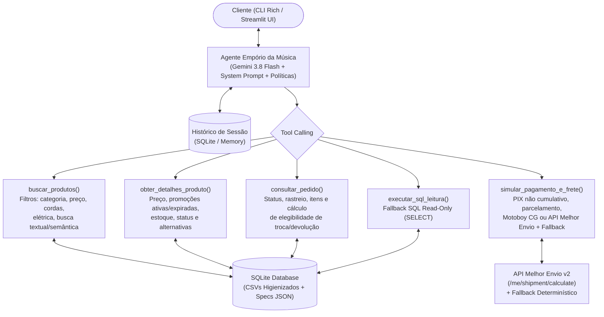

# Plano de Ação Consolidado — Desafio Técnico AI Engineer (Artef4ct)

Com base nas decisões técnicas selecionadas, este documento consolida a arquitetura final, a avaliação de integração com a API do **Melhor Envio** e o roteiro de implementação para o agente de atendimento da **Empório da Música**.

---

## 1. Resumo das Decisões Técnicas Escolhidas

| Dimensão | Escolha Definida | Justificativa Técnica |
| :--- | :--- | :--- |
| **Abordagem do Agente** | **Híbrida**: Tools de negócio determinísticas sobre SQLite + Políticas completas no *System Prompt* + Tool de *fallback* SQL *read-only* | Garante 100% de precisão em regras críticas (cálculo de PIX não cumulativo, parcelamento escalonado, filtros de estoque/status e sugestão de similares), evita perda de contexto por *chunking* no manual de 235 linhas e mantém flexibilidade total com uma tool SQL somente-leitura para consultas analíticas ad-hoc. |
| **Orquestração** | **SDK Nativo (`google-genai`) + `Pydantic`** (sem LangChain/LangGraph) | Código limpo, auditável, sem abstrações opacas, com validação estrita de entradas/saídas via schemas Pydantic e controle transparente do loop de *function calling* e rastreamento de chamadas. |
| **Modelo / Provedor** | **Google Gemini (`gemini-3.8-flash`)** via Google AI Studio | Modelo mais atualizado e rápido da família Gemini Flash, com excelente capacidade de *tool calling* em português, baixa latência, suporte nativo a instruções de sistema e configurável via variável `GEMINI_MODEL` no `.env`. |
| **Cálculo de Frete** | **Híbrido: Regra Local (Campo Grande) + API Melhor Envio com Fallback Determinístico** | Aplica a regra de motoboy próprio (Seção 5.1) para Campo Grande e integra a API v2 do **Melhor Envio** (PAC, SEDEX e Jadlog `.Package`) com *fallback* offline automático caso o avaliador não possua token configurado. |
| **Interfaces & Persistência** | **CLI Interativa (`Rich`) + Web UI (`Streamlit`)** com histórico persistido em **SQLite / Exportação Markdown** | A CLI agiliza testes no terminal e exportação de conversas; o Streamlit oferece uma experiência visual moderna com um **Inspetor de Tool Calls** lateral para demonstrar o raciocínio do agente em tempo real. |

---

## 2. Tratamento de Dados e Regras de Negócio (Anomalias Mapeadas)

Durante a exploração dos arquivos em `data/`, identificamos casos de borda que serão tratados na camada de dados/ferramentas:

1. **Conflito entre `status` e `stock_quantity` em `products.csv`**:
   - `product_id = 96` (*Giannini GF-3D Dreadnought Sunburst*, R$ 799,90): `status = active`, mas `stock_quantity = 0`. A ferramenta sinalizará **indisponibilidade temporária** e retornará alternativas disponíveis na mesma categoria/faixa de preço (Política 7.3).
   - `product_id = 136` (*Ibanez Bass 2X Electric Bass*): possui `stock_quantity = 13`, mas `status = discontinued`. A ferramenta bloqueará a oferta como disponível, informará que foi **descontinuado** e sugerirá baixos ativos equivalentes (Política 7.3).
   - `product_id = 113` (*Shelby SN-7C 7 Cordas Nylon Natural*): `status = discontinued` e `stock_quantity = 0`.
   - `product_id = 130` (*Kala KA-ABP-CTG Barítono Cedar*): `status = coming_soon` e `stock_quantity = 2` (sinalizado como pré-lançamento/em breve).
2. **Extração de `specs` JSON**:
   - A coluna `specs` de `products.csv` será expandida/indexada em SQLite (cordas `nylon`/`steel`, `electronics` `yes`/`no`, `top`, `color`, `body_type`, etc.) para permitir filtros precisos (ex.: *"violão de nylon elétrico"* ou *"tampo sólido"*).
3. **Promoções Ativas vs. Expiradas (`promotions.csv`) e Regra do PIX**:
   - Apenas 4 promoções estão com `is_active = 1` (produtos `90`, `94`, `121`, `127`) e 21 estão expiradas (`is_active = 0`, incluindo o *Takamine GD20*, `product_id = 95`).
   - A ferramenta de detalhes do produto exibirá tanto a promoção ativa (com preço original, % de desconto e preço promocional) quanto o histórico de promoção expirada (para que o agente explique com transparência caso o cliente pergunte sobre uma promoção antiga, conforme Política 7.3).
   - O cálculo de pagamento aplicará os **5% de desconto no PIX apenas quando o produto não tiver promoção ativa** (Política 6.2).
4. **Regras Escalonadas de Parcelamento e Inconsistências do Manual**:
   - A calculadora de pagamento implementará as faixas da Seção 3.1: até 3x sem juros (parcela mín. R$ 50), 4x a 6x (parcela mín. R$ 80) e 7x a 12x (parcela mín. R$ 100), além de combinação de pagamentos para compras acima de R$ 2.000.
   - O agente conhecerá ambos os telefones citados no manual: fixo `(67) 3341-4444` e WhatsApp `(67) 3321-4500`, e o e-mail normalizado sem acento `contato@emporiodamusica.com.br`.
5. **Elegibilidade de Troca e Devolução (`orders.csv`)**:
   - Como os pedidos datam de `2025-10-15` a `2026-03-22`, usaremos uma data de referência configurável (`REFERENCE_DATE`, padrão `2026-03-25`) para calcular de forma determinística se um pedido está dentro do prazo de **7 dias corridos** (arrependimento/preferência) ou **30 dias corridos** (defeito de fabricação), ou se requer acionamento da garantia legal (90 dias) / fabricante.

---

## 3. Avaliação Técnica: Uso da API do Melhor Envio para Cálculo de Frete

Avaliamos a viabilidade técnica de integrar a API do **Melhor Envio** (`POST /api/v2/me/shipment/calculate`) em confronto com os dados de `products.csv` e as regras da **Seção 5 (Política de Frete e Entregas)** de `politicas_da_loja.md`.

### 3.1 Alinhamento com o Negócio
A Seção 5.2 do manual da loja especifica exatamente as três modalidades operadas nativamente pelo Melhor Envio:
- **PAC (Correios)** — Service ID `1` no Melhor Envio (5 a 12 dias úteis, com seguro e rastreio).
- **SEDEX (Correios)** — Service ID `2` no Melhor Envio (2 a 5 dias úteis, com seguro e rastreio).
- **Jadlog (.Package)** — Service ID `3` no Melhor Envio (3 a 8 dias úteis, com seguro e rastreio).

### 3.2 Desafios Técnicos e Lacunas nos Dados (Data Gaps)
Ao cruzar os requisitos do endpoint `/api/v2/me/shipment/calculate` com os arquivos fornecidos no desafio, identificamos **4 obstáculos práticos**:

1. **Ausência de Peso e Dimensões em `products.csv`**:
   - A API do Melhor Envio exige obrigatoriamente `width` (cm), `height` (cm), `length` (cm), `weight` (kg) e `insurance_value` (R$) para cada produto/volume.
   - Porém, a coluna `specs` de `products.csv` contém apenas atributos musicais (`top`, `back_sides`, `neck`, `strings`, `scale`, `electronics`, `color`, `keys`, `pieces`, etc.), **sem peso nem dimensões físicas**.
   - **Solução**: Criar uma tabela de **Perfis Físicos por Categoria/Porte (`CATEGORY_SHIPPING_PROFILES`)** com dimensões e pesos reais de mercado:
     - *Ukuleles (Cat. 9)*: `65 x 25 x 12 cm`, `1.2 kg`
     - *Violões (Cat. 5)*: `105 x 45 x 16 cm`, `3.2 kg`
     - *Guitarras (Cat. 1)*: `105 x 40 x 12 cm`, `4.5 kg`
     - *Baixos (Cat. 2)*: `122 x 42 x 12 cm`, `5.2 kg`
     - *Teclados/Arranjadores portáteis (Cat. 4)*: `100 x 40 x 18 cm`, `7.0 kg`
     - *Pianos Digitais 88 teclas e Baterias Acústicas (Cat. 3 e 4 — Grande Porte)*: Acionam também o alerta da Seção 5.2 (*"Instrumentos de grande porte podem exigir frete especial com cotação individual"*) e priorizam transportadora (Jadlog), já que os Correios possuem limite de 100 cm por dimensão e 200 cm na soma `C + L + A`.
2. **CEP Fictício da Loja no Manual (`79202-333`)**:
   - O manual informa `CEP 79202-333` para a loja no Centro de Campo Grande/MS. Na base oficial dos Correios/Melhor Envio, a faixa `79200-000` pertence a Aquidauana/MS, enquanto o Centro de Campo Grande utiliza `79002-xxx` (ex.: `79002-070`).
   - **Solução**: Na chamada à API externa do Melhor Envio, utilizar o CEP postal válido do Centro de Campo Grande (`79002070`) como `from.postal_code`, mantendo a exibição do endereço oficial do manual para o cliente.
3. **Exceção da Região Metropolitana de Campo Grande (Seção 5.1)**:
   - Para entregas em Campo Grande (faixa de CEP `79000-000` a `79129-999` ou cidade informada como Campo Grande), a loja **não usa Correios/Jadlog**: a entrega é feita por **motoboy próprio** (1 a 3 dias úteis), com **Frete Grátis** para compras > R$ 500,00 e **taxa fixa de R$ 35,00** para compras $\le$ R$ 500,00.
   - **Solução**: A ferramenta intercepta destinos em Campo Grande antes de chamar a API externa, aplicando a regra determinística da Seção 5.1.
4. **Fricção de Autenticação para o Avaliador (Token OAuth2)**:
   - A API do Melhor Envio (mesmo no ambiente Sandbox `https://sandbox.melhorenvio.com.br`) exige um Bearer Token (`Authorization: Bearer ...`) gerado por uma conta cadastrada. Se o projeto dependesse exclusivamente da API com token obrigatório, o avaliador da Artef4ct não conseguiria testar o frete sem criar uma conta no Melhor Envio.
   - **Solução (Padrão Strategy com *Graceful Fallback*)**:
     - Se `MELHOR_ENVIO_TOKEN` estiver configurado no `.env`, a tool realiza a requisição HTTP real para `https://sandbox.melhorenvio.com.br/api/v2/me/shipment/calculate` (ou produção) filtrando os serviços `1,2,3` (PAC, SEDEX, Jadlog `.Package`) com `insurance_value` igual ao valor do pedido.
     - Se `MELHOR_ENVIO_TOKEN` estiver vazio (ou em caso de indisponibilidade/timeout da API), a tool utiliza automaticamente o **Simulador Determinístico Local** calibrado com as faixas de CEP do Brasil, cubagem da categoria, seguro incluso e os prazos oficiais da Seção 5.2 (PAC: 5–12 dias úteis; SEDEX: 2–5 dias úteis; Jadlog: 3–8 dias úteis), indicando na resposta a fonte do cálculo (`melhor_envio_api` vs. `tabela_contingencia_loja`).

---

## 4. Arquitetura Proposta (Visão Geral)



---

## 5. Estrutura de Arquivos do Projeto

```text
ai_eng_artef4ct/
├── data/                        # Dados originais (CSVs + politicas_da_loja.md)
├── src/
│   ├── __init__.py
│   ├── config.py                # Configurações via .env (GEMINI_API_KEY, GEMINI_MODEL="gemini-3.8-flash", MELHOR_ENVIO_TOKEN)
│   ├── database.py              # Ingestão/higienização dos CSVs para SQLite + expansão de specs JSON
│   ├── schemas.py               # Modelos Pydantic para entradas e saídas estruturadas das tools
│   ├── shipping.py              # Cliente da API Melhor Envio + Perfis de cubagem por categoria + Fallback local
│   ├── tools.py                 # Tools de negócio + fallback executar_sql_leitura
│   ├── prompts.py               # System Prompt (Persona + Políticas + Guardrails de escopo/LGPD)
│   ├── memory.py                # Persistência de sessões e mensagens em SQLite + exportação Markdown
│   └── agent.py                 # Orquestrador com SDK nativo google-genai e rastreamento de tool calls
├── app.py                       # Interface Web em Streamlit (Chat + Inspetor de Tool Calls)
├── cli.py                       # Interface de linha de comando interativa com Rich
├── generate_examples.py         # Script para executar e exportar os cenários de conversa
├── examples/                    # 4 a 5 conversas completas em Markdown cobrindo casos triviais e complexos
├── tests/
│   ├── test_database.py         # Testes de integridade e limpeza dos dados
│   ├── test_shipping.py         # Testes de cálculo de frete (Campo Grande, Melhor Envio mock/API e fallback)
│   └── test_tools.py            # Testes das regras de negócio (estoque, status, PIX, parcelamento, trocas)
├── implementation_plan.md       # Este plano de implementação na raiz do projeto
├── .env.example                 # Template de variáveis de ambiente
├── requirements.txt             # Dependências enxutas (google-genai, pydantic, httpx, rich, streamlit, pytest)
└── README.md                    # Documentação completa exigida pelo desafio
```

---

## 6. Sequência de Commits Incrementais

Para construir um histórico Git limpo e realista:
1. `chore: configure project structure, dependencies and implementation plan`
2. `feat(data): implement SQLite ingestion pipeline and JSON specs normalization`
3. `feat(shipping): add Mejor Envio API v2 client with category dimensions and local fallback`
4. `feat(tools): add deterministic business tools for catalog, pricing, orders and SQL fallback`
5. `feat(agent): implement Gemini 3.8 Flash native tool-calling agent, persona prompt and SQLite memory`
6. `feat(ui): build interactive Rich CLI and Streamlit web chat with tool inspector`
7. `docs: add conversation examples and comprehensive technical documentation in README`

